# Görsel ve prototip arşivi — 25 Ekim 2026

Bu klasör mevcut çıktıların değişmeden alınmış sürümlü kopyasıdır; yeni render/model üretilmedi. Reddedilen denemeler de karar geçmişidir. Aynı dosya adı yerelde sonradan değişse bile bu commit ve hash eski içeriği tanımlar. Tarih tek başına sürüm kimliği değildir; Git commit ve SHA256 birlikte kullanılmalıdır.

## Kapsam ve erişim

20 medya dosyası GitHub’da, yaklaşık 7.7 MB: 16 proje görseli, 3 proje animasyon videosu ve 1 lisanslı referans panosu. `inventory.json` 186 mevcut yerel dosyanın boyut/hash/erişim durumunu içerir; 186 dosyanın tamamının GitHub’da olduğu veya tek tek görsel incelendiği anlamına gelmez. `link-index.json` mevcut kayıtlardan 46 kaynak bağlantısı kaydını ve bulundukları dosyaları tutar; yeni ziyaret/doğrulama iddiası değildir. Ham çıkarılmış bağlantılarda Markdown kapanış işareti bulunabilir; özgün `outputs/morphometry/sources.json` ve `outputs/eye-analysis/skin-reference-source.json` kesin kaynak adresleridir.

Büyük Blender dosyaları, tam referans videoları ve lisansı belirsiz üçüncü taraf görseller yerelde kalır. Kaynak URL tek başına görselin kalıcı yedeği değildir. Geçici macOS ekran görüntüsü yollarındaki kullanıcı eklerinin tamamı bu envantere alınmadı; kaybolmuş dosyalar varmış gibi gösterilmez. Bu arşiv tam çalışma alanı yedeği değildir.

## Sürümleme ve kaynak ilkesi

- Önce kaynak/çıktı hash’i doğrulanır; yeni içerik yeni tarih/sürüm yoluna eklenir, tarihsel görsel değiştirilmez. Aynı hash için gereksiz kopya oluşturulmaz.
- Her yeni prototip: kaynak sürüm, üretim betiği, parametre, çıktı, kabul/ret gerekçesi, ilgili referans ve test kapsamıyla kaydedilir. Mevcut ayrıntılar bir üst klasördeki geliştirme kaydındadır.
- Kendi renderlarımız ile biyolojik referanslar karıştırılmaz. Bir render bilimsel kanıt değildir.
- Lisansı belirsiz görseller için kaynak/yerel hash korunur; kamuya açık kopya ancak uygun izin/lisansla eklenir.
- Aşağıdaki CC referansın lisansı yalnız o türeve uygulanır; tüm repo için lisans beyanı değildir.

## Prototiplerin görsel yolculuğu

### İlk deri: D5 düz/köşeli inceleme

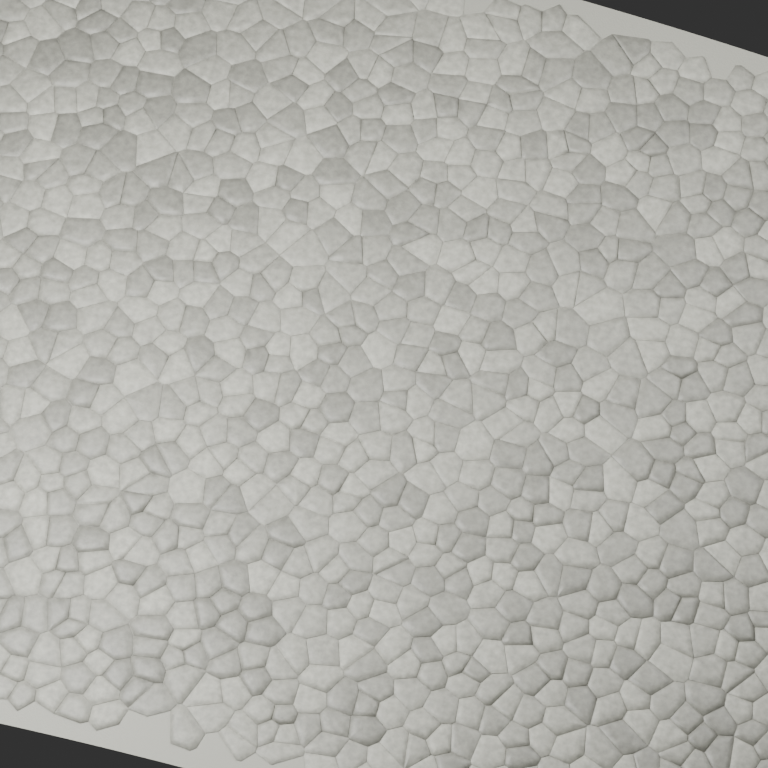

### D5.1 bombeli deri

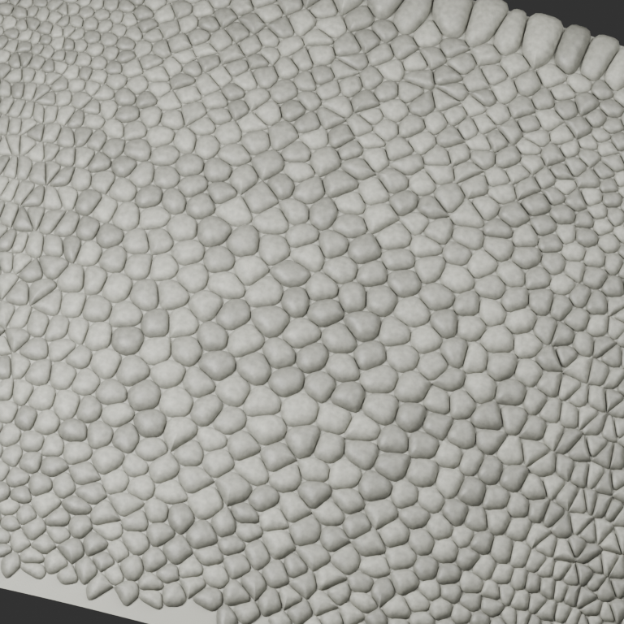

### D5.3: sonradan reddedilen düğme göz

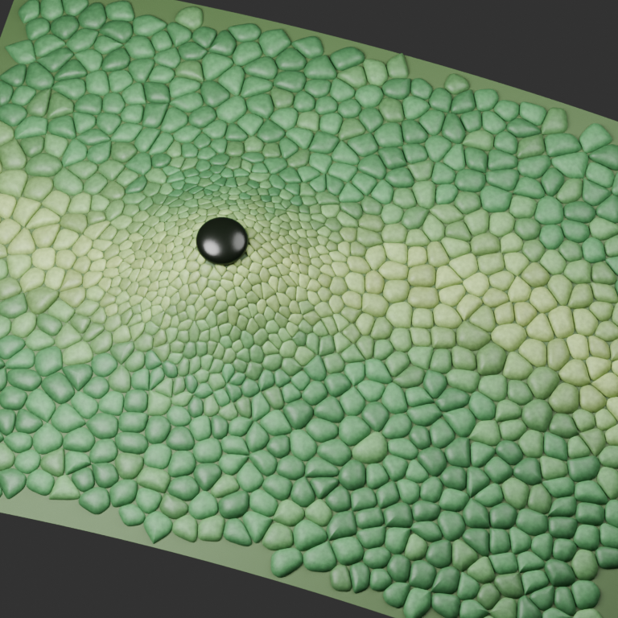

### Gövde siluetinin düzeltilmesi

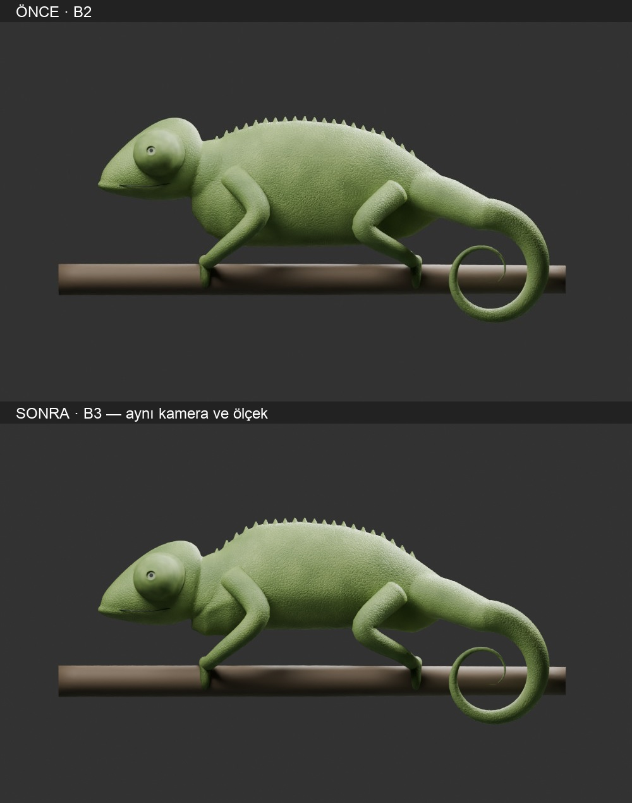

### v5 / G2: reddedilen kökten göz hareketi

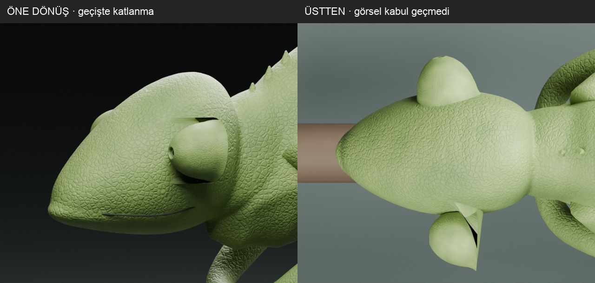

### v7 / G4: açıklık oranı ve pozlar

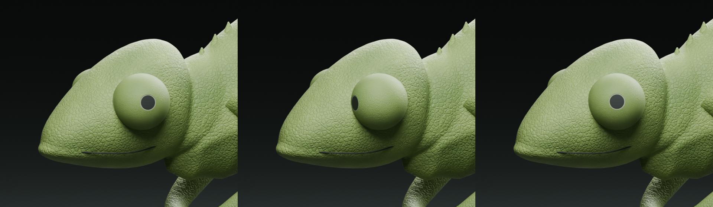

### v8 / G5: deri kıvrımları

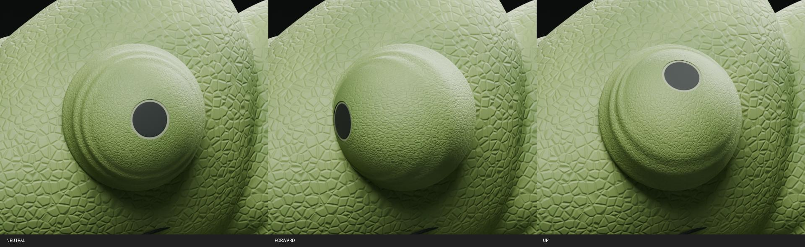

### v9 / G6: bombeli pulların geri aktarılması

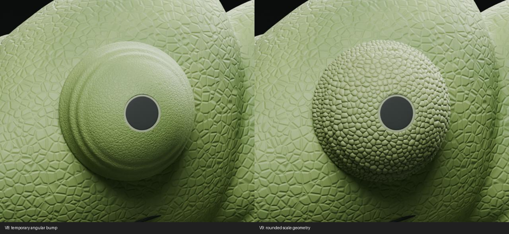

### v10 / G7: öne bakış açıklık payı

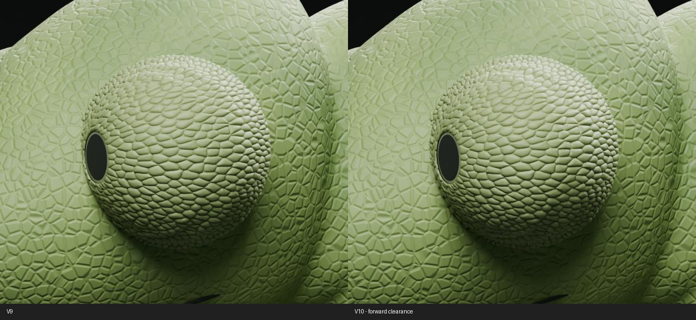

### v12 / G8: ışığa tepki veren göz

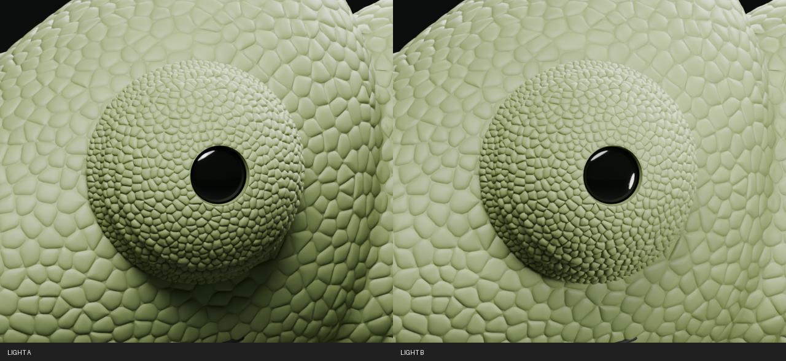

### v13 / G9: eliptikleşmenin azaltılması

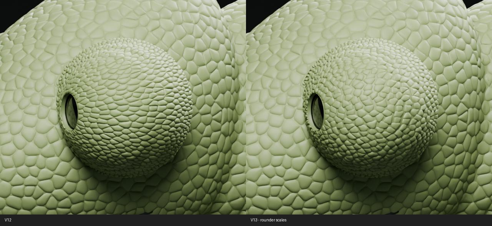

### v14 / G10: henüz yeterli bulunmayan kenar

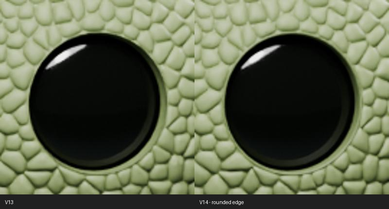

### v15 / G11: krater profili; düz halka sorunu sürüyordu

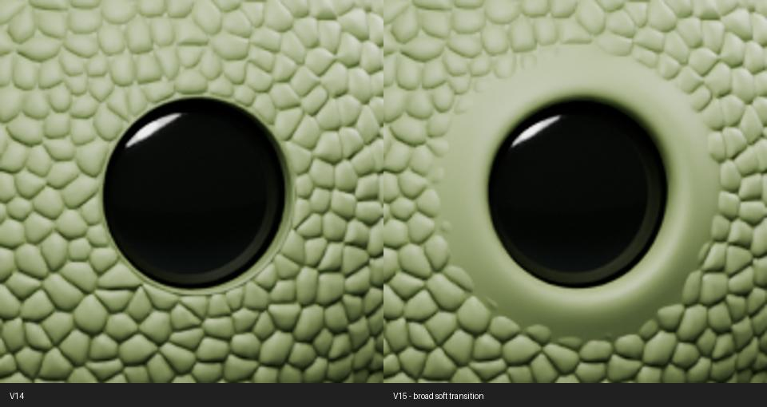

### v16 / G12: desenin kenara yayılması

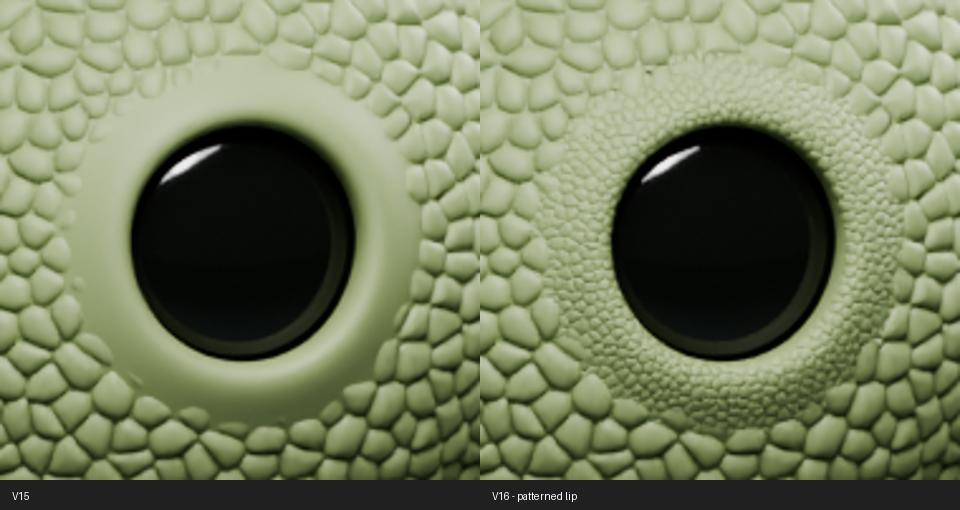

### v17: güncel yakın görünüm

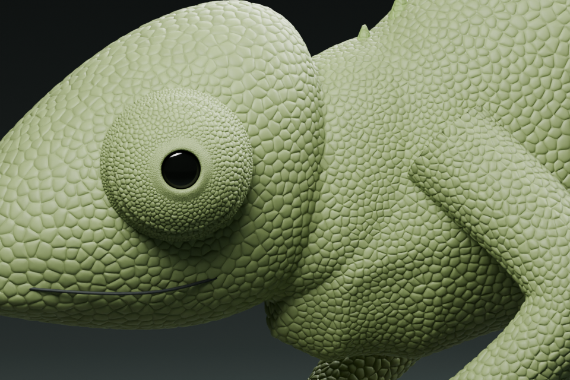

### v17: güncel genel görünüm

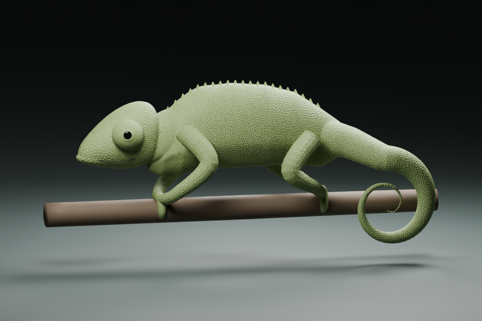

## Hareket videoları

Bu videolar tarihsel yakın göz deneyleridir; güncel v17 tam beden animasyonu değillerdir.

- [v6: küresel yüzey üzerinde hareket](outputs/eye-analysis/single-eye-surface-motion.mp4)
- [v8: deri kıvrımı denemesi](outputs/eye-analysis/single-eye-skin-folds.mp4)
- [v9: hareketli bombeli pullar](outputs/eye-analysis/single-eye-rounded-scales.mp4)

## Gerçek panter göz referansı

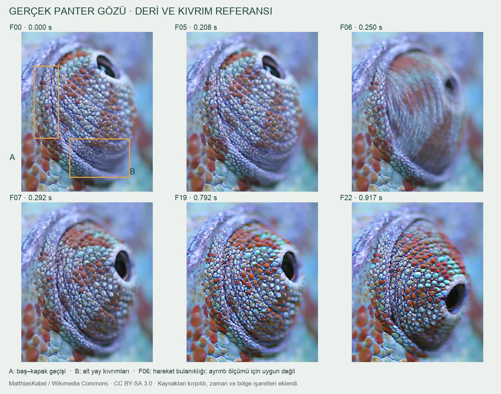

Kaynak: [Furcifer pardalis moving eyes](https://commons.wikimedia.org/wiki/File:Furcifer_pardalis_moving_eyes.ogv), MatthiasKabel. [CC BY-SA 3.0](https://creativecommons.org/licenses/by-sa/3.0/). Bu pano kaynaktan kırpılmış, zaman/bölge işaretleri ve Türkçe açıklamalar eklenmiş bir türevdir; aynı CC BY-SA 3.0 lisansı ile sunulur. Kaynakta araştırılan hareketi gösterir; proje renderı değildir. Kare/hash bilgisi arşivdeki `outputs/eye-analysis/skin-reference-source.json` dosyasında.

## İlgili analiz

- [Tasarım evrimi](../../16-design-evolution.md)
- [Bölgesel araştırma ve eksikler](../../17-regional-skin-evidence.md)
- [Ayrıntılı göz geliştirme günlüğü](../eye-development-log.md)
- [Gövde ölçüm yöntemi](../morphometry-analysis.md)
- [Makinece okunabilir envanter](inventory.json)
- [Kaynak bağlantıları dizini](link-index.json)
