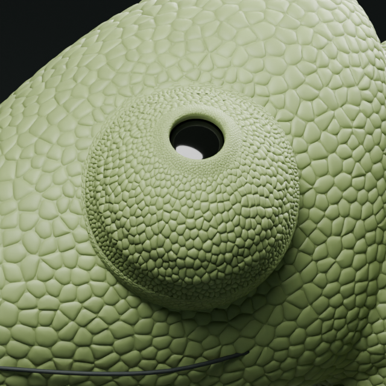
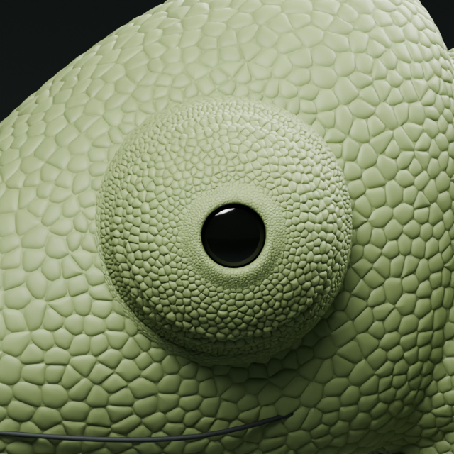
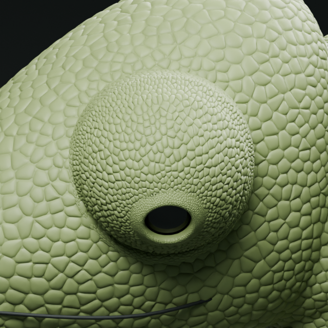

# V19 aday — bakış yönüne bağlı kök derisi

25 Ekim 2026. Kullanıcının üç fotoğraflı düzeltmesi: göz yukarı bakarken üst bağlantı daralmalı, aşağı bakarken alt bağlantı daralmalı; nötrde dağılım daha dengeli olmalı. Bu, v18'in neredeyse sabit genişlikteki kök katmanını düzeltir; siyah açıklığın çevresi değildir.

## Uygulama ve sınır

V18 ayrı korunarak v19 üretildi. Yalnız önceki ek kök yüzeyi ve onun ince pulları değiştirildi. Başa oturan dış sınır sabit. Göz tarafındaki bağlantı mevcut kapak üzerinde bakışın düşey bileşenine göre farklı halkalara oturuyor: nötr 12, yönlü değişim en fazla yaklaşık 9 halka. Bu değer ölçülmüş anatomi değil tasarım parametresi. Geçiş açısal konuma göre sürekli; ani üst/alt bölge eşiği yok. Kök pulları aynı seed, hücre biçimi ve bombelik yöntemiyle yeni yüzeyi izler. Ana gözün kullanıcı kabulü olan pulları yeniden üretilmedi/değiştirilmedi.

Bu hareket yüzey üzerinde kayan bir görsel bağlanma yaklaşımıdır; tek parça biyolojik deri mekaniği değildir. Yeni katman alttaki bazı kök pullarını örtebilir. Manifold birleşim, tüm pul çarpışmaları ve gerilme fiziği henüz çözülmedi. Renk/materyal eklenmedi. Aday kullanıcı kabulü bekler; v17 kabul edilmiş doku referansı olmaya devam eder.

## Üç poz

### Yukarı — üst bağlantı daralır

### Nötr

### Aşağı — alt bağlantı daralır

## Kontrol

Dosya yeniden açıldı; ana göz pulu, kapak, optik yüzey, açıklık kenarı ve ana bedenin geometri/şekil anahtarı hashleri kaynakla aynı. 179 tam/yarım karede dış sınır kayması 0; sonlu olmayan koordinat yok. Modelde sabit üst/alt açısal sektörlerde yüzey boyunca ortalama yay uzunluğu:

| Poz | Üst | Alt |
|---|---:|---:|
| Nötr | 0.08181 | 0.06318 |
| Yukarı | 0.03978 | 0.11281 |
| Aşağı | 0.15935 | 0.05969 |

Sayılar sahne birimidir; fotoğraftaki görünür alan, milimetre veya biyolojik strain ölçümü değildir. İstenen yön dört karşılaştırmada sağlandı. Aşağı bakışta alt daralma daha hafif; simetrik tepki veya nihai doğallık iddia edilmiyor. Görseller incelendi. Bu küçük işte yeni video üretilmedi; Blender dosyasında 90 karelik hareket vardır.

Yerel model: `outputs/eye-root-v19/chameleon-eye-root-v19.blend`; büyük dosya GitHub'a yüklenmedi. `build.py` kaynak v18 dosyasını gerektirir, v19 adayını yazar; `verify.py` yeniden açma ve yön testidir. Kaynak/çıktı hashleri `manifest.json` içinde. Sonraki karar, üç pozun görsel kabulü ve özellikle aşağı daralmanın yeterliliğidir; ana pul deseni korunmalıdır.
