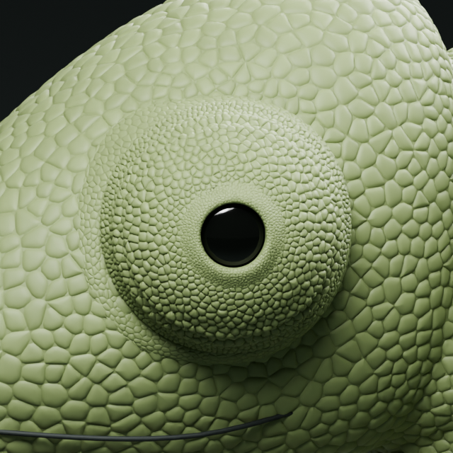
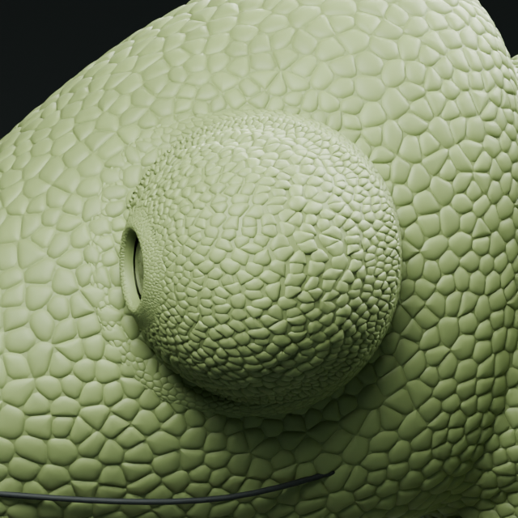

# V20 aday — burun tarafındaki kök bağlantısı

25 Ekim 2026. Kullanıcı “ön” ile siyah göz açıklığını değil gözün buruna yakın kafa bağlantısını, “arka” ile kuyruğa yakın bağlantıyı kastettiğini ekran görüntüsüyle netleştirdi. Arka taraftaki biçim ve hareket beğenildi; o taraf korunmalıdır.

## Teşhis ve kapsam

V19 nötr pozunda karşılıklı örnek kesitler ölçüldü: burun tarafında yüzey yayı yaklaşık 0.02993, kuyruk tarafında 0.06416 sahne birimi. Bu yerel fark küçük pulların ön tarafta sıkışmış görünmesini açıklayan bir aday nedendir; fotoğraftan bilimsel ölçü değildir, bütün çevrenin ortalaması da değildir.

V19 korunarak ayrı V20 üretilir. Yalnız burun tarafında yumuşak ağırlık maskesiyle kafa üzerindeki dış oturma noktası genişletildi. İç geçişte düşey bakış tepkisine buruna yönelik yatay bakış etkisi eklendi. Kuyruk tarafındaki maskenin değeri sıfırdır. İlk denemede ön nötr genişliği iyileşti fakat buruna bakışta daralma yeterli değildi; aynı onaysız adayın yalnız yatay etki katsayısı artırıldı. Ana gözün kabul edilen pulları, siyah açıklık çevresi ve optik yüzey değişmedi.

Aynalama yapılmadı: arka tarafın kafaya oturduğu konum ön tarafta anatomik olarak aynı değil. Amaç aynı piksel geometrisini kopyalamak yerine benzer yumuşak geçiş ve yönlü hareket davranışı. Yeni kök katmanı hâlâ ayrı ek yüzeydir; tüm kesişimler ve manifold birleştirme tamamlanmadı. İnce yeni kök pulları mevcut taban pullarının bir kısmını örtebilir. Tam biyolojik deri fiziği iddia edilmez.

## Aday görseller

### Nötr

### Buruna doğru bakış

## Koruma ve kontrol

`manifest.json` kaynak/çıktı SHA256, kabul edilen göz nesnelerinin geometri/şekil anahtarı hashleri, arka taraf karşılaştırması, 179 tam/yarım karede dış sınır sabitliği ve beş pozda yerel yay uzunluklarını tutar. Arka taraf testi kök yüzeyi ve kök pullarında başlangıç x > -2.00 bölgesini, saklanan bütün şekil anahtarlarında karşılaştırır; bunu tüm çevrede her piksel aynı diye yorumlama. Kaynak V19 korunur.

Yerel Blender: `outputs/eye-root-v20/chameleon-eye-root-v20.blend`. Nötr 1, kuyruğa bakış 15, buruna bakış 29, yukarı 43, aşağı 57; Space ile mevcut 90 kare oynatılabilir. Yeni video bu dilimde üretilmedi. Büyük Blender dosyası GitHub'da değil; görseller, betikler ve ölçümler arşivlenir. Üretim `build.py`, doğrulama `verify.py`, ilk salt okunur teşhis `inspect.py`. V20 kullanıcı kabulü bekler; V17 ana pul dokusu kabulü geçerlidir.

### Son ölçüm ve açık fark

Nötr örnek kesitte ön yay 0.06156, arka yay 0.06416 sahne birimi: önceki yaklaşık iki kat fark azaldı. Arka bölgede test edilen deri/pul noktalarının saklanan tüm şekil anahtarlarında farkı 0; 179 ara/tam karede baş sınırı kayması 0. Buruna bakışta ön yay 0.06313, kuyruğa bakışta 0.15364: iki bakış arasında belirgin toparlanma vardır, fakat buruna bakışta nötrden daha kısa bir yay elde edilmedi. Bu nedenle ön ve arka davranışın tam eşdeğerliği tamamlandı diye sunulmaz. İkinci ayar ilk adaya göre buruna bakış yayını azalttı; görsel kabul ve gerekirse bu yerel uç pozun tekrar ayarı açık kalır.
