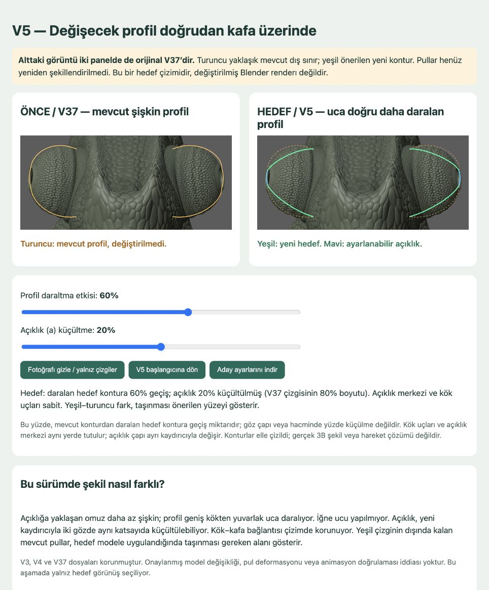

# Göz şekli karar demosu — V5

28 Ekim 2026. **V37 fotoğrafı üzerinde interaktif 2B hedef konturlar. Blender modelinin yeni sürümü değildir.**

- [V5 demo](index.html): profil daraltma + bağımsız açıklık küçültme.
- [V4](v4/index.html): aynı kafa üzerinde profil karşılaştırması, açıklık sabit.
- [V3](v3/index.html): ayrı geometrik şema, kafa üzerindeki farkı göstermediği için V4'e geçildi.
- [Araştırma, kararlar ve revizyonlar](RESEARCH_AND_DECISIONS.md).
- [Test kaydı](verification-v5.json), [ölçüm verileri](evidence/), [kaynak dosya hash'leri](source-manifest.json).

## Açma ve kullanım

`index.html` dosyasını tarayıcıda açın veya repo kökünden `python3 -m http.server 8781 --bind 127.0.0.1` çalıştırıp `/docs/chameleon/eye-shape-review-v5/` yolunu açın. Framework, paket kurulumu veya build gerekmez. GitHub dosya görünümü HTML'yi çalıştırmaz; bu commit tek başına canlı yayın değildir.

1. **Profil daraltma etkisi, 0–100:** mevcut konturdan daralan hedefe interpolasyon miktarı. Göz çapında yüzde küçülme değildir.
2. **Açıklık (a) küçültme, 0–40:** iki açıklığın 2B konturuna aynı ölçek uygulanır. %20 seçimi, başlangıç uzunluğunun %80'ini bırakır. Profil ayarından bağımsızdır.
3. **Fotoğrafı gizle:** yalnız mevcut/hedef çizgilerle farkı gör.
4. **Başlangıca dön:** profil 60, açıklık 0, fotoğraf açık. Bu bir kabul edilmiş nihai şekil değildir.
5. **Aday ayarlarını indir:** sürümlü JSON; model dosyası değil.

Turuncu: yaklaşık mevcut sınır. Yeşil: hedef. Mavi: ayarlanan açıklık. Alttaki pul görüntüsü iki panelde de aynı V37 renderıdır; konturlar hareket ettiğinde görüntüdeki pullar değişmez.

## Doğrulama

`node test-demo.cjs`: 16 profil/açıklık kombinasyonunda iki açıklığın uzunluğu, merkez korunumu, sonlu SVG, bağımsız kontroller; sıfırlama, fotoğraf anahtarı ve JSON çıktısı denetlenir. Bu test küçük DOM taklidiyle gerçek demo scriptini çalıştırır. Gerçek tarayıcıda kaydırıcılar, sıfırlama ve görünüm anahtarı da kullanıldı; ekran görüntüsü kaydedildi. İndirme payload'ı test edildi; tarayıcı indirmesinin diske kaydı ayrıca doğrulanmadı.

Bu, anatomi, pul gerilmesi, iç göz teması, rig veya animasyon testi değildir. V37 `.blend`/`.glb` ve çalışan göz hareketleri değiştirilmedi. V3/V4 korunmuştur. `main` ve canlı siteye entegrasyon bu görevin kapsamında değildir.
