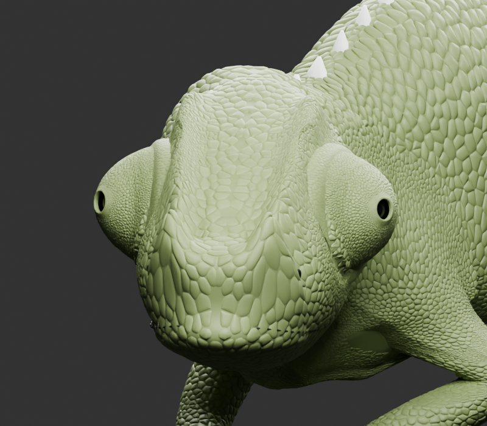
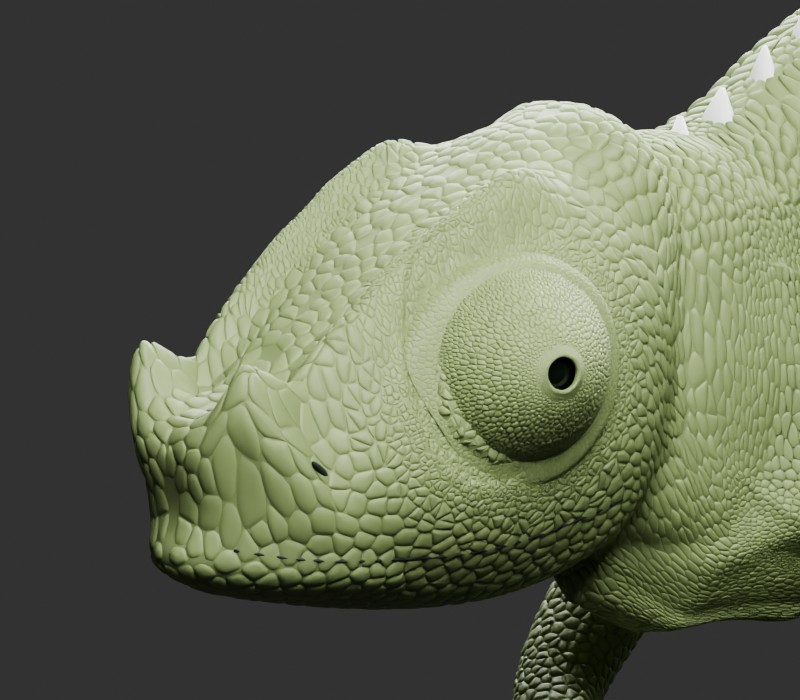
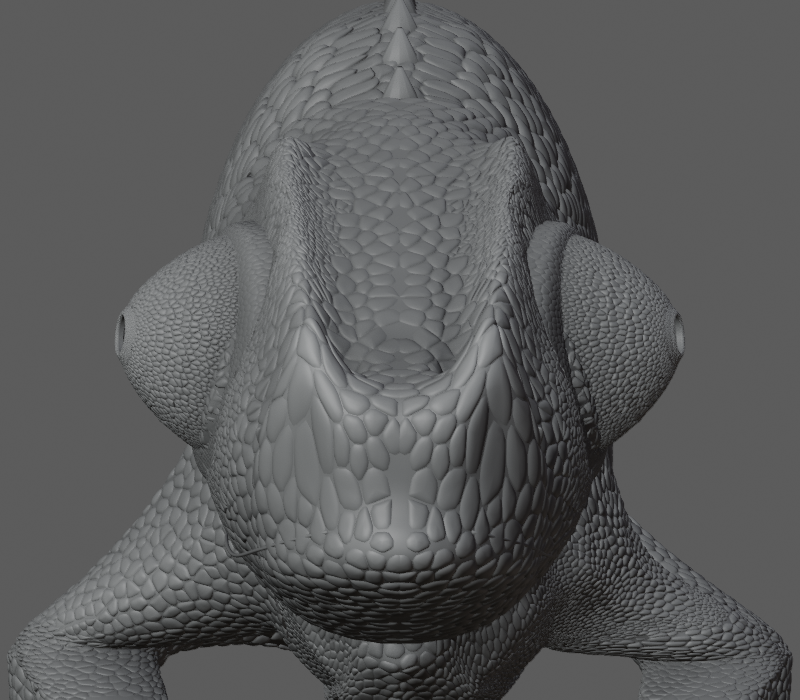

# VFinal_Eye — kabul edilen göz profili

28 Ekim 2026. Kullanıcı V8 demosunda **profil %50 / açıklık küçültme %15 / derinlik %75** kararını verdi. Bu teslim, son V37 karakteri üzerinde yalnız göz yüzeyini revize eder. G1 eski modeli güncel karakterin yerine geçirilmedi.

## Dosyalar

- Düzenlenebilir Blender yedeği: **VFinal_Eye.blend**
- Kendine yeterli, animasyonlu glTF Binary: **VFinal_Eye.glb**
- [Kabul edilen demo](demo/index.html): 50 / 15 / 75 ile açılır ve bu değerlere sıfırlanır; G1'in dört orijinal görünüşünü içerir. Yerelde doğrudan açılabilir; GitHub dosya görünümü HTML çalıştırmaz.
- [Kesin karar](decision.json), [geometri koruma kaydı](build-verification.json), [aktarım kontrolü](export-verification.json).
- [Göz derinliği araştırması](research/ANALYSIS.md), [ölçüm verileri](research/measurements.json).
- `source/`: yalnız göz revizyonu ve doğrulama kodları, gerekli profil verileri.

Büyük ikili dosyalar normal Git blob'u olarak eklenmez; bu repo'nun sürüm indirmelerindedir:

- [VFinal_Eye.blend indir](https://github.com/alphanAkbulut/portfolio/releases/download/vfinal-eye-2026-10-28/VFinal_Eye.blend)
- [VFinal_Eye.glb indir](https://github.com/alphanAkbulut/portfolio/releases/download/vfinal-eye-2026-10-28/VFinal_Eye.glb)
- [GitHub sürümü](https://github.com/alphanAkbulut/portfolio/releases/tag/vfinal-eye-2026-10-28)

SHA-256 değerleri `export-verification.json` ve `SHA256SUMS.txt` içinde; GitHub yüklemesi ayrıca yayın kaydında doğrulanır. Canlı portföy sitesi değiştirilmedi.

## Hangi kaynak neden seçildi?

G1 küçük göz formu `outputs/body-study/chameleon-study-v4.blend` içindedir. Eski üretim kodunda radyal 0,68 ve eksen yönünde 0,82 katsayısı uygulanmış. Bu katsayılar V37'ye ikinci defa uygulanmadı. G1 yalnız kabul edilen boyut/profil referansıdır; eski burun, ağız veya gövdesi geri taşınmadı.

En son düzenlenebilir kaynak `outputs/eyes-v37/chameleon-animated-v37.blend`. Kaynak SHA-256: `387d5181f1ed7185183bb8fb738b4f3b9242884ca075330bdec602941da41628`. V37, önceki uzuv ve deri düzeltmelerini, burun/ağız çalışmasını ve beş animasyonu içerir. G1 ile V37 kök boyutları yakınken orta profilin daha dolgunlaşmış olduğu göz yüzeyi ölçümünde görüldü. Bu, büyük görünüşü yalnız tek bir global ölçek kaybıyla açıklamamamız gerektiğini gösterir. Hangi tarihsel adımda görünüşün değiştiği bütünüyle izlenmedi.

V5–V7 büyük V37 görüntüsü üzerinde çalışıyordu; V8 kullanıcı isteğiyle G1 görüntüsüne geçti. V8 iki tarafta aynı şematik profili kullanır. Bu kopyada açıklık düz kenar olarak gösterilir; gerçek açıklığın dikdörtgen olduğu iddiası değildir.

## 2B karardan 3B yüzeye geçiş

Demo parametreleri yüzde hacim küçültme veya biyolojik ölçüm değildir. Profil %50, iki Bézier omuz eğrisi arasında yarı geçiştir; a %15, uç açıklığının %85 kalmasıdır; L %75, referans derinliğin %75 kalmasıdır.

3B yorum: V8 üst/alt kesit yarıçaplarının ortalaması göz ekseni etrafında yuvarlatılmış bir zarf oluşturur. Zarf G1'in mevcut kök yarıçapıyla ölçeklenir. G1'in ölçülen eksen derinliği 0,303204 model birimi; hedef 0,227403 (%75). Demo piksel L/B=0,56875, gerçek 3B ölçü diye aktarılmaz; iki farklı izdüşüm/eksen tanımı vardır. G1 tabanına göre 3B yarıçap ve açıklık değerleri üretim kaydındadır. Bu bir sanatsal 3B uyarlamadır, 2B görüntünün benzersiz fiziksel rekonstrüksiyonu değildir.

V37'nin kaynak vertex kimlikleri kullanılarak yalnız Near/Far eye parçaları seçildi. Örtü, pullar, açıklık kenarı ve optik iç nesneler aynı sürekli deformasyon alanıyla taşındı. Kök çevresindeki ilk 0,055 eksen mesafesinde yumuşak geçiş, tabandaki mevcut oturmayı korur. İki taraf aynı dönüşümün aynalanmış halini kullanır. Pul nesneleri yeniden üretilmedi, materyal ya da UV sistemi değiştirilmedi.

## Neler korundu?

- Göz dışındaki **1.874.485 Body vertex'i birebir aynı**; burun/ağız, ense, uzuv ve kuyruk geometri değişikliğine dahil değil.
- Body topolojisi, vertex ağırlıkları ve malzeme atamaları korunur. Göz pulları yüzeyle birlikte şekil değiştirir; boyutlarının her yönde sabit kaldığı iddia edilmez.
- Mesh adları: `Body`, `LeftEye`, `RightEye`.
- Rig: `ChameleonRig`, toplam 97 kemik; göz kontrolleri mevcut adlarıyla `Eye_L`, `Eye_R`; boyun `Neck_Bone`. Yeniden adlandırma yok.
- Beş Action: `walk`, `idle_look`, `drink`, `tail_coil`, `tail_wave`. Kaynak ve hedef FCurve hash'leri aynı; mevcut bağımsız göz zamanlaması silinmedi.
- Kemik rest konumları ve 21 PBR malzeme aynı.

## Texture ve web aktarımı

V37 kaynağında resim texture dosyası veya prosedürel shader düğümü yok. Pullu görünüm gerçek mesh geometrisi, renk/roughness gibi PBR malzeme değerleriyle oluşuyor. Bu nedenle GLB'de `images=0` olması kayıp texture anlamına gelmiyor. Mevcut bütün geometri ve PBR materyaller GLB içinde; harici buffer/image bağlantısı yok. Blender kaydında pack-all kontrolü de yeni paketlenecek dosya bulmadı.

GLB React Three Fiber / Three.js glTF yükleyicilerinde kullanılabilecek standart biçimdedir; bu görev Next.js uygulaması kurmadı veya tarayıcı performans optimizasyonu yapmadı. Yaklaşık 180 MiB tam detay dosyasıdır; otomatik oynatma uygulama tarafındaki animasyon oynatıcısıyla başlatılır. Mobil/üretim performansı ayrıca değerlendirilmelidir. Bu teslimde geometri azaltılmadı.

## Doğrulama ve sınırlar

1. Blender yedeği yeniden açıldı.
2. Beş Action'ın başlangıç/orta/son pozlarında değerlendirilen mesh koordinatları sonlu: 15 poz kontrolü.
3. Nötr ön/yan/üst/üç çeyrek görseller ve `idle_look` tarama/odak, `drink` orta pozları render edilip incelendi. İç göz görünür, kabul edilen daha dar profil korunuyor. Bu örnekleme bütün karelerde çarpışmasızlık garantisi değildir.
4. GLB JSON ve binary başlığı gerçek dosyadan okundu: üç mesh, beş klip, 97 joint, 21 malzeme, sıfır dış dosya bağımlılığı.
5. GLB bağımsız olarak boş Blender sahnesine yeniden alındı. Üç karakter mesh'i ve beş Action okundu. İçe aktarıcının oluşturduğu 42 vertex'li `Icosphere`, pose-bone `custom_shape` referanslarıyla kemik kontrol görseli olarak doğrulandı; GLB'nin dördüncü karakter mesh'i değildir.
6. Demo 64 ayar kombinasyonunda kontrol edildi; reset 50/15/75 ve JSON aktarımı doğrulandı.

İlk üretimde çap–yarıçap dönüşüm hatası görsel kontrolde yakalandı; yayımlanan dosyalarda düzeltildi. Hatalı deneme yerelde `work/vfinal-eye/attempt-01` içinde ayrıldı, nihai pakete alınmadı. Eski modeller ve demolar korunmuştur.

Nihai profil kullanıcının seçtiği ayarlardan üretildi. Yeni 3B renderların kullanıcı tarafından ayrıca görsel kabul edildiği varsayılmıyor.

## Görseller

## Tekrar üretim

Kaynak V37 blend, `source/build.py` ve `source/` içindeki G1 profil/veri dosyaları gerekir. Scriptin `R`, `W`, `O` yolları repo'daki özgün yerel proje düzenini gösterir; başka makinede bu üç yolu uyarlayın. `eye-parts.json` yalnız göz kaynak aralıklarını içerir. Üretimden sonra `export_verify.py` yeniden açma/GLB dışa aktarma ve kontrolü yapar. `reimport.py` dışa aktarılan dosyanın bağımsız yükleme kontrolüdür.
